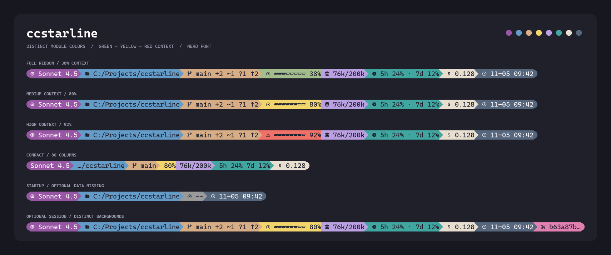

# ccstarline

用 Go 编写的 Claude Code 状态栏。单个可执行文件，无需 Node.js、PowerShell 脚本或后台服务。

参考 `starship` 的 ribbon 调色板、圆角端点和 Powerline 箭头，配色和布局直接写在 `config.go` 中：



| 模块         | 配色             | 显示内容                                  |
| ------------ | ---------------- | ----------------------------------------- |
| model        | 紫色 `#9857a4`   | Nerd Font 图标、当前模型                  |
| directory    | 天蓝 `#649bc7`   | 当前目录、路径截断与目录图标替换          |
| git          | 沙棕 `#d6ad85`   | 分支、暂存、修改、未跟踪、冲突、领先/落后 |
| context      | 动态：淡绿 → 明黄 → 珊瑚红 | 当前上下文进度条、使用百分比；未知时为中性灰 |
| tokens       | 浅薰衣草紫 `#baa0e0` | 当前请求 Token / 上下文上限            |
| usage        | 青绿 `#41a6a0`   | 5 小时/7 天额度使用比例                   |
| cost         | 米白 `#e7ded0`   | 会话估算美元费用                          |
| time         | 深灰蓝 `#56677d` | 本地日期和时间，使用浅色文字               |
| session      | 粉色 `#e080b0`   | 会话 ID 前缀（可选）                      |

## 构建和预览

```powershell
go build -trimpath -ldflags="-s -w" -o ccstarline.exe .
./ccstarline.exe --preview --color
./ccstarline.exe --preview --color --width 100
./ccstarline.exe --preview --no-color
```

`--preview` 使用内置演示数据；实际运行由 Claude Code 传入当前会话 JSON。

已提供 Windows、Linux、macOS 的 amd64/arm64 预编译二进制（`.zip` / `.tar.gz`）和 `checksums.txt`，见 [Releases](https://github.com/pizixi/ccstarline/releases)。下载后解压即可使用，运行机器不需要安装 Go，也不需要外部样式文件。

## 发布

`.github/workflows/release.yml` 在推送 `main` 时读取 `main.go` 中的 `var version`：如果对应的 `vX.Y.Z` 标签不存在，就自动创建标签、交叉编译上述六个平台、生成 SHA-256 校验和并发布 GitHub Release。升级版本只需修改 `version` 并推送到 `main`。

也可以直接推送 `v*` 标签，或在 Actions 页面手动触发 `Release` workflow 并填写版本号（手动触发会重新构建并覆盖同名 Release 资产）。版本号通过 `-ldflags "-X main.version=..."` 注入，`go build` 的默认值仍为源码中的版本。

## 接入 Claude Code

将 `claude-settings.example.json` 中的 `statusLine` 对象合并到用户配置 `~/.claude/settings.json`。保留原有的其他字段。

示例文件已指向本目录的实际绝对路径；移动程序后修改路径。Windows 路径使用 `/`，带空格的路径也应保留内部双引号。

```json
{
  "statusLine": {
    "type": "command",
    "command": "\"C:/path/to/ccstarline.exe\" --color",
    "padding": 0,
    "refreshInterval": 5
  }
}
```

Claude Code 会在每次调用时，通过 stdin 传入当前会话的 JSON；程序渲染后退出，由 Claude Code 接收 stdout 并显示在状态栏。`refreshInterval` 让时间在空闲期间也能更新；会话数值仍以 Claude Code 提供的最新快照为准。

没有修改你现有的 Claude Code 全局设置。

## 调整配色和布局

直接修改 `config.go` 的 `defaultConfig()`，然后重新执行上面的构建命令。所有默认样式集中在这个函数中。

`Colors` 中的颜色使用 `0xRRGGBB` 格式，例如：

```go
"user_bg":      rgb(0x9857a4), // 模型：紫色
"directory_bg": rgb(0x649bc7), // 目录：天蓝
"git_bg":       rgb(0xd6ad85), // Git：沙棕
"language_bg":  rgb(0x9a9a9a), // 未知上下文：中性灰
"context_low_bg":  rgb(0xa3be8c), // 上下文：低占用淡绿
"context_mid_bg":  rgb(0xf2d56b), // 上下文：中占用明黄
"context_high_bg": rgb(0xf07167), // 上下文：高占用珊瑚红
"tokens_bg":    rgb(0xbaa0e0), // Token：浅薰衣草紫
"docker_bg":    rgb(0x41a6a0), // 额度：青绿
"cost_bg":      rgb(0xe7ded0), // 费用：米白
"time_bg":      rgb(0x56677d), // 时间：深灰蓝，搭配浅色文字
"session_bg":   rgb(0xe080b0), // 会话：粉色
```

其他设置也直接在同一函数中调整：

- `Options.Modules`：模块顺序即显示顺序；删除名称即可隐藏模块。`tokens`（当前请求输入与缓存 Token / 上下文上限）已默认启用；另有可选模块 `session`（会话 ID 前缀）。
- `Options.BarWidth`：上下文进度条长度，默认 8。
- `Options.GitTimeoutMS`：Git 查询超时毫秒数，默认 500。
- `Options.TimeLayout`：Go 时间模板，默认 `01-02 15:04`；只显示时分可改为 `15:04`。
- `Directory` 和 `GitBranch`：目录截断、目录图标替换和 Git 分支图标。

原始 `starship.toml` 只保留作为设计参考；程序没有 `--config` 参数，也不会读取 TOML 或 `STARSHIP_CONFIG`。

## 显示行为

- 上下文占用按区间换色：低于 75% 淡绿 `#a3be8c`，75%–89% 明黄 `#f2d56b`，90% 起珊瑚红 `#f07167` 并显示警示图标。首次请求前未知的上下文以中性灰显示 `--`。各模块使用独立底色，避免 Git 与中占用、目录与高占用，以及额度与费用之间撞色。`tokens` 模块与上下文之间不画箭头，直接换色。
- 额度和费用只使用 Claude Code 提供的字段。字段不存在时隐藏相应模块；不请求账户接口、不读取凭据。费用是会话估算值。
- Git 标记：`+` 暂存、`~` 工作区修改、`?` 未跟踪、`!` 冲突、`↑/↓` 领先/落后。无 Git 仓库、Git 未安装或查询超时时隐藏 Git 模块。
- 优先使用 Claude Code 提供的 `COLUMNS`。也可用 `--width N` 指定宽度。窄屏时先缩短路径、分支、时间和进度条，再隐藏次要模块。最后保留模型和上下文；极窄时使用短文本。
- `--no-color` 或非空的 `NO_COLOR` 环境变量可关闭 ANSI 颜色；`--color` 强制使用颜色，优先于 `NO_COLOR`。接入示例已显式启用颜色。`--ascii` 替换图标、箭头和进度条装饰；实际目录或分支名中的中文会保留。
- 支持中文和组合字符的终端宽度计算；外部文本中的 ANSI 控制序列会被过滤。Nerd Font 图标按一个终端单元格计算。

## 手动传入会话数据

```powershell
Get-Content -Raw -Encoding UTF8 ./examples/session.json | ./ccstarline.exe
```

程序只渲染传入的会话，不会主动寻找或连接其他 Claude Code 窗口。`--preview` 中的 Git 状态是演示值；正常模式查询传入工作目录的真实 Git 状态。

## 验证

```powershell
go test ./...
go vet ./...
```

测试覆盖缓存输入的上下文计算、缺失数据、中文路径、时间显示、1–180 列的布局、终端控制字符、Git 重命名/分离 HEAD，以及临时 Git 仓库中的真实状态。
